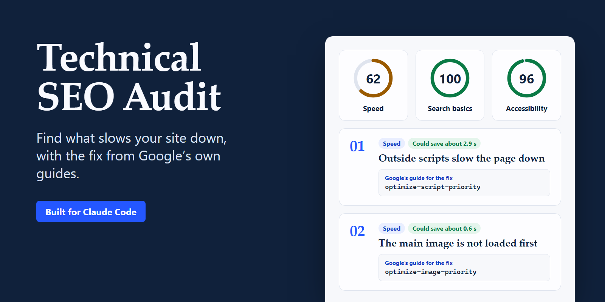
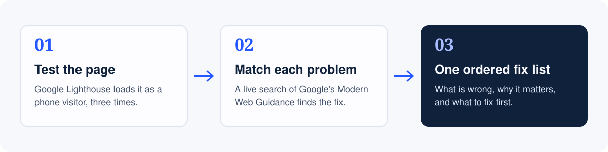

<p align="center"></p>

<p align="center"><strong>Google Lighthouse finds it · Google's own guides fix it · Runs on your computer</strong></p>

<p align="center"><a href="#start-with-one-prompt">Get started</a> · <a href="examples/example-report.md">See an example</a> · <a href="SETUP.md">Setup guide</a> · <a href="https://israelseofreelancer.com/">Work with Zechariah</a></p>

# A straight answer to "what is technically wrong with my site?"

Most technical audits hand you a score and a list of jargon. You still do not know what to fix first, or how.

This workflow runs Google's own test on any page, then looks up Google's own instructions for each problem it finds. You get one report: what is wrong, why it matters, and the fix, in order of how much it helps. **It reads the page. It does not change your website.**

Built by [Zechariah Tokar](https://israelseofreelancer.com/), an independent SEO consultant. It uses [Google Lighthouse](https://github.com/GoogleChrome/lighthouse) and [Google Chrome's Modern Web Guidance](https://github.com/GoogleChrome/modern-web-guidance). This is an independent project, not an official Google or Anthropic product.

## Start with one prompt

Give Claude Code this repository link and paste:

> Set up the technical SEO audit from https://github.com/ztokar/technical-seo-audit on my computer. Read AGENTS.md and SETUP.md and handle the technical setup. Then audit my home page and my most important service page as a phone visitor. Tell me the three fixes that matter most, in plain words, with the Google guide behind each one. Do not change my website.

Claude Code handles the terminal work. You need Node.js and Google Chrome on your computer. No account, no API key and no payment are required for the basic audit.

Prefer to run it yourself?

```
git clone https://github.com/ztokar/technical-seo-audit
cd technical-seo-audit
node audit.mjs https://your-site.com
```

<p align="center"></p>

## What the audit answers

| Your question | What the workflow checks |
|---|---|
| Is my site slow on a phone? | Load speed and Google's Core Web Vitals, measured three times, middle result reported. |
| What is slowing it down? | Each failing check, ranked by the time it could save. |
| Is it my site or the tools bolted onto it? | Analytics, ad tags, pixels and chat widgets, with the weight of each. |
| Can Google read and list this page? | Title, description, crawlable links and indexability. |
| How do I fix it? | The matching guide from Google's Modern Web Guidance for each problem. |

## It stays current without maintenance

Lighthouse and Modern Web Guidance are both maintained by Google and both change often. This workflow keeps no copy of either. Every run fetches the latest version of each, and the guide for each problem is found by a live search, never from a fixed list. When Google updates its test or publishes a new guide, your next audit uses it.

## See the report

**Illustrative example only. Harbor Street Dental is a fictional business and these are not client results.**

| Area | Score |
|---|---:|
| Speed | 62 |
| Search basics | 100 |
| Accessibility | 96 |
| Good practice | 77 |

The first finding in the example: three outside scripts weigh 458 KB, and the main photo takes 8.6 seconds to appear on a phone. The fix list starts there, not with the 40 smaller items a raw Lighthouse report would show.

[Read the full illustrative report →](examples/example-report.md)

## What a real run found

On one client site, this audit showed that tags for ad campaigns that were no longer running were the heaviest thing on every page. Removing them and marking the main photo as top priority moved the home page from 62 to 98 on Google's phone speed test, and the main photo from 8.6 seconds to 2.4. Analytics kept running. One site, one result; yours will differ.

## What this does not do

It audits one page at a time. It does not crawl your whole site, and it knows nothing about keywords, content, links or structured data. A clean report means the page is technically sound, not that the SEO is finished. Speed is one ranking signal among many, so no audit can promise a ranking change.

## Want help with your audit?

Run it yourself, or talk to me if you want the fixes made, the results explained, or a second opinion on what matters.

**[Work with Zechariah →](https://israelseofreelancer.com/)**

I work directly with businesses on search visibility and practical AI workflows. Bring your site and what a useful outcome would look like.

## Your data stays with you

- The audit runs on your computer. Reports are saved to a local folder that Git ignores.
- Only test pages you own or are allowed to test.
- With the optional PageSpeed key, the page address is sent to Google's PageSpeed service. Without it, nothing leaves your computer except the normal visit to the page.
- Never post a client report or an API key in a public issue. See [SECURITY.md](SECURITY.md).

<details>
<summary><strong>Technical details and validation</strong></summary>

Requires Node.js 18 or newer and Google Chrome. No packages are installed into this repository; `npx` fetches `lighthouse@latest` and `modern-web-guidance@latest` on each run. `audit.mjs` writes `report.html`, `report.md` and `report.json` to `./audits/<site>-<date>-<device>/`.

Speed is measured three times by default and the middle run is reported, because single runs vary. A slow computer lowers a locally measured score. Set a free `PAGESPEED_API_KEY` to measure from Google's servers and add 28 days of real-visitor data where Google has it. [SETUP.md](SETUP.md) explains how.

Validated on Windows 11 with Node 24 and Chrome: full audit runs, an address containing `&`, a site that refused the test, and the report page at phone and desktop widths. Not yet validated on macOS or Linux.

References: [Lighthouse](https://github.com/GoogleChrome/lighthouse) · [Modern Web Guidance](https://github.com/GoogleChrome/modern-web-guidance) · [PageSpeed Insights API](https://developers.google.com/speed/docs/insights/v5/get-started).

</details>
